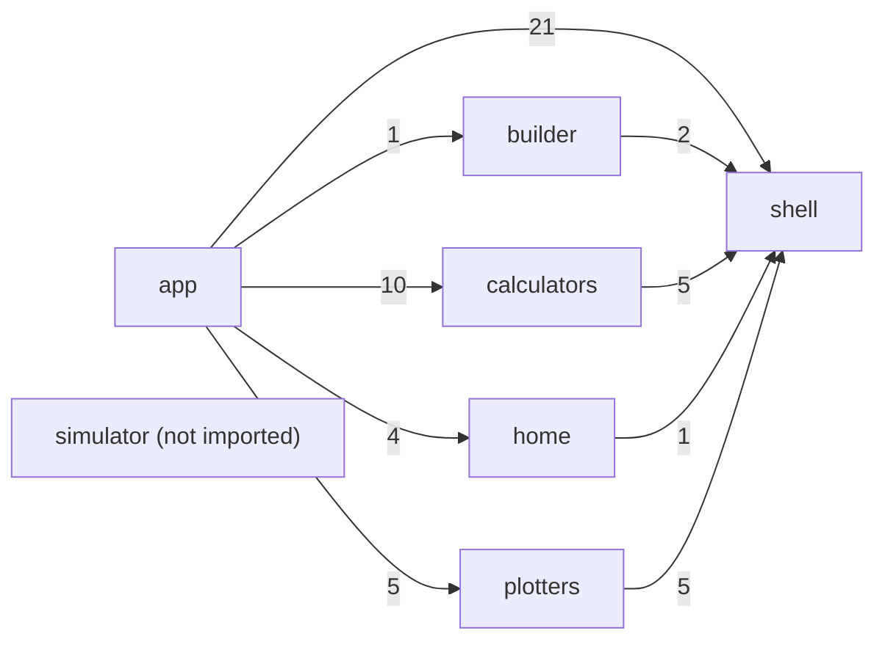
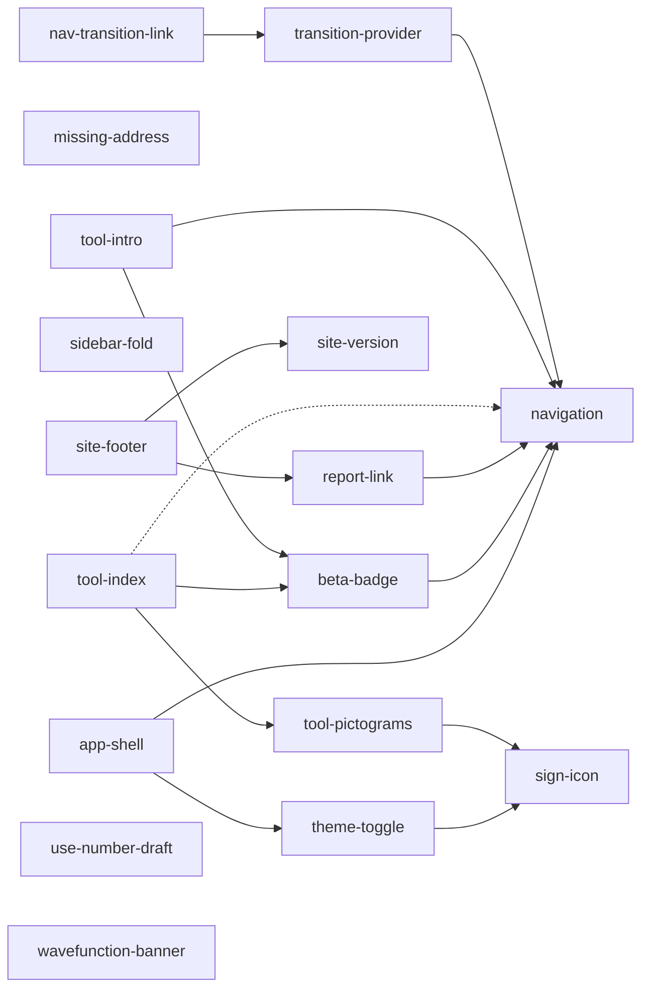
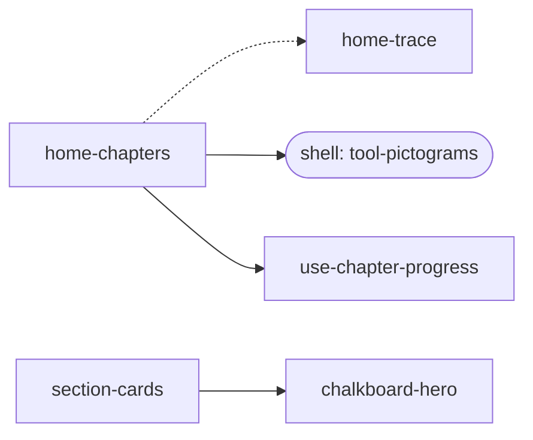
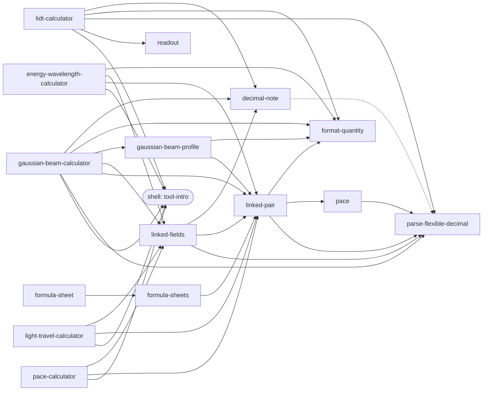
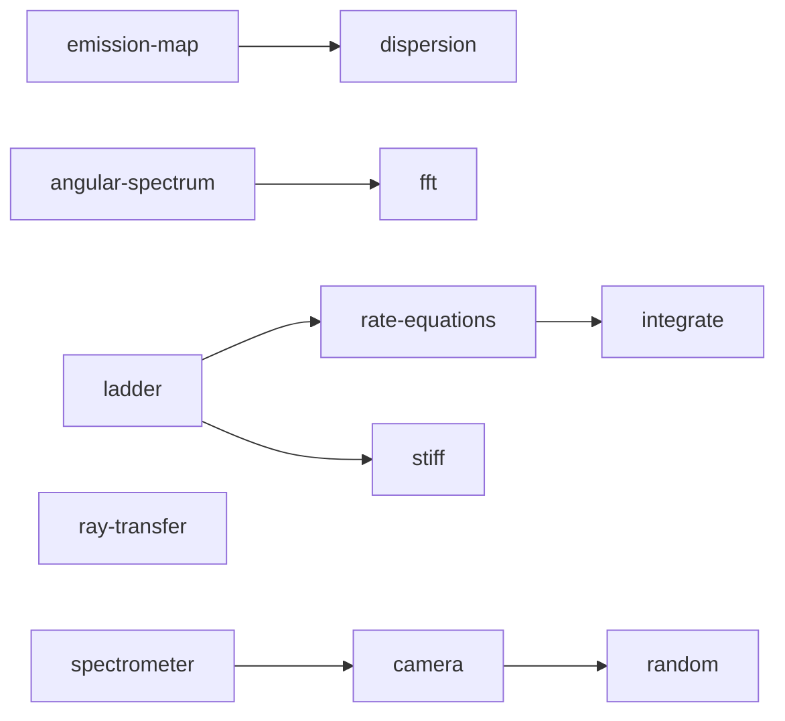

# QUOP module map

A map of every source module under `src/` (140 files, ~34k lines), as of
`d21ed7f` on 2026-11-16. Tests (`*.test.ts`), Playwright specs (`tests/ui`),
`scripts/` and JSON fixtures are left out.

The import edges were extracted mechanically: every relative and `@/` import,
including `import type`, re-exports and dynamic `import()`. External packages
(React, three.js, Chart.js, …) are not drawn. The graph has 320 internal edges.

**Findings in brief**

- **Circular imports: none.**
- **Physics mixed with rendering: four modules** (see [Physics mixed with rendering](#physics-mixed-with-rendering)).
- **Unused modules:** all of `simulator/`, `wavefunction-banner.tsx`, and
  `nav-transition-link.tsx` with `transition-provider.tsx` behind it.

## Contents

1. [Areas](#areas)
2. [Modules, one sentence each](#modules-one-sentence-each)
3. [Import graphs](#import-graphs)
4. [Adding a new optical component](#adding-a-new-optical-component)
5. [Circular imports](#circular-imports)
6. [Physics mixed with rendering](#physics-mixed-with-rendering)
7. [Unused modules](#unused-modules)

## Areas

| Area | Path | What it is |
|---|---|---|
| app | `src/app/` | Next.js App Router routes. Each page is a thin wrapper around a component, or a redirect. |
| shell | `src/components/*.ts(x)` | Site chrome and shared bits: navigation registry, header, footer, theme, pictograms, tool intro. |
| home | `src/components/` (hero, chapters, cards) | The homepage's chalkboard hero and scroll chapters. |
| calculators | `src/components/calculators/` | Five linked-field calculators and their formula sheets. |
| plotters | `src/components/plotters/` | CSV, array and FITS plotters on Chart.js, a three.js surface view, SVG/PDF export. |
| builder | `src/components/builder/` | The Tabletop: a 3D optical-table layout notebook (React Three Fiber). |
| simulator | `src/components/simulator/` | Pure-TS physics (FFT, ODE solvers, polariton models, spectrometer). No page imports it. |

How the areas depend on each other (edge counts on the arrows):

## Modules, one sentence each

### app

| Module | What it does |
|---|---|
| `app/layout.tsx` | Root layout: fonts, theme bootstrap, the version meta tag, and the app shell and footer around every page. |
| `app/page.tsx` | Homepage: the chalkboard hero, the scroll chapters and the section cards. |
| `app/not-found.tsx` | The 404 page, exported once as static HTML, that echoes the missing address and links back to the sections. |
| `app/notes/page.tsx` | Static Notes page. |
| `app/calculators/page.tsx` | Calculators section index, listed from the navigation registry. |
| `app/calculators/*/page.tsx` (5) | One route per calculator: tool intro, the calculator, its formula sheet. |
| `app/plotters/page.tsx` | Plotters section index, listed from the navigation registry. |
| `app/plotters/*/page.tsx` (5) | One route per plotter: tool intro and the plotter. |
| `app/builder/tabletop/page.tsx` | The Tabletop route; mounts the builder through its client-only loader. |
| `app/builder`, `app/experiment`, `app/experiment/builder` | Redirects to `/builder/tabletop`. |
| `app/theory`, `app/lidt`, `app/energy-wavelength-calculator` | Legacy redirects to Notes and to the calculators' current addresses. |

### shell (site-wide components)

| Module | What it does |
|---|---|
| `navigation.ts` | The registry of sections and tools (labels, routes, beta flags) that menus, indexes and intros read. |
| `app-shell.tsx` | The site header: wordmark, section menus with hover drop-downs, and the theme toggle. |
| `site-footer.tsx` | The footer: version and the report-a-problem link. |
| `site-version.ts` | Reads the package version at build time so footer, package and release tag agree. |
| `report-link.tsx` | A report link whose address is joined in the browser so it never sits whole in static HTML. |
| `theme-toggle.tsx` | Day/night switch that falls back to following the system when the choice matches it. |
| `sign-icon.tsx` | The station pictogram frame: an outline icon inside a bordered square, leading a sign. |
| `tool-pictograms.tsx` | Each tool's station pictogram, drawn for `SignIcon`. |
| `tool-index.tsx` | A section's tools as sign-styled rows with pictogram, arrow and blurb. |
| `tool-intro.tsx` | A tool's title block, named from the registry, with its beta badge. |
| `beta-badge.tsx` | Shows a "beta" badge when the registry marks a tool beta. |
| `sidebar-fold.tsx` | Folds a tool's sidebar away and back from the hairline beside the plot. |
| `use-number-draft.ts` | Hook that keeps a number field's typed text as a draft until it spells a number. |
| `missing-address.tsx` | Prints the unknown path on the static 404, read in the browser. |
| `transition-provider.tsx` | Context that plays a page-transition overlay on navigation (only used by `nav-transition-link`). |
| `nav-transition-link.tsx` | A `Link` that triggers the page transition first. **Not imported anywhere.** |
| `wavefunction-banner.tsx` | A decorative wavefunction banner. **Not imported anywhere.** |

### home

| Module | What it does |
|---|---|
| `chalkboard-hero.tsx` | The homepage hero: chalk-drawn physics marks laid out on a board, with tunable "taste knobs". |
| `home-chapters.tsx` | The pinned scroll chapters, whose chalk drawings and readouts are driven by one progress number. |
| `home-trace.ts` | Generates the SVG path data (and peak location) for the chapter trace drawing. |
| `section-cards.tsx` | The four section cards with hand-wobbled edges. |
| `use-chapter-progress.ts` | Hook mapping scroll position to a chapter's progress, unpinned on narrow screens. |

### calculators

| Module | What it does |
|---|---|
| `linked-pair.ts` | Pure two-field linking (typing in one rewrites the other) plus the physical quantities and constants the calculators convert between. |
| `pace.ts` | Pure running pace ↔ speed conversion and rounding. |
| `parse-flexible-decimal.ts` | Reads numbers typed with either decimal comma or point and reports how an ambiguous one was read. |
| `format-quantity.ts` | Formats answers to a few significant figures with SI prefixes. |
| `formula-sheets.ts` | Each calculator's equations and symbol glossary, as TeX. |
| `formula-sheet.tsx` | Renders a calculator's formula sheet with KaTeX and a Symbols fold. |
| `linked-fields.tsx` | The two linked input fields with unit pickers and announcements. |
| `readout.tsx` | A calculator's large result readout. |
| `decimal-note.tsx` | The note under a field saying how an ambiguous number was read. |
| `energy-wavelength-calculator.tsx` | Photon energy ↔ wavelength, with a Raman shift section. |
| `light-travel-calculator.tsx` | Distance ↔ light travel time. |
| `pace-calculator.tsx` | Running pace ↔ speed. |
| `lidt-calculator.tsx` | Pulse energy and beam radius → fluence and peak fluence for LIDT checks. |
| `gaussian-beam-calculator.tsx` | Waist ↔ Rayleigh range for a Gaussian beam with λ, M² and index, plus divergence. |
| `gaussian-beam-profile.tsx` | Interactive SVG plot of the beam envelope w(z) and a cross-section intensity slice. |

### plotters

| Module | What it does |
|---|---|
| `csv-parsing.ts` | The shared CSV/TSV reader (delimiters, headers, clock cells), React-free. |
| `csv-series.ts` | Picks each CSV plotter's series from a parsed table. |
| `xy-selection.ts` | The generic CSV plotter's X/Y column-choice rules. |
| `array-input.ts` | Parses the Array plotter's typed x and y arrays. |
| `clock-axis.ts` | An x axis of clock time with day roll-over labels. |
| `demo-csv.ts` | Made-up sample CSVs shown before a file loads. |
| `plotter-source.ts` | Where a plotter's data comes from (bundled sample, file, typed text), as plain state. |
| `use-plotter-source.ts` | Hook around that state that lets only the latest load through. |
| `fits-file.ts` | Reads a FITS file (via `@fits-js/core`) into an image or series summary. |
| `fits-header.ts` | Turns FITS header cards into labelled chips and sections for display. |
| `fits-errors.ts` | Turns FITS read errors into actionable sentences. |
| `image-axes.ts` | Maps frame pixels to canvas coordinates (row 0 at the bottom, DS9-style). |
| `pixel-aspect.ts` | The pixel aspect both FITS views share. |
| `surface-geometry.ts` | Downsampling, grid mesh and pick-back for the Surface view, as plain arrays. |
| `colormaps.ts` | The colormaps and the routine that paints a frame with them. |
| `figure-spec.ts` | Chart state in, Chart.js data and options out; the only module that knows Chart.js option shapes. |
| `chart-style.ts` | Which look the charts use: matplotlib skin or classic Chart.js. |
| `matplotlib-skin.ts` | Matplotlib-like defaults (boxed frame, inward ticks) drawn over Chart.js. |
| `chart-fonts.ts` | The charts' web font, kept apart so non-Next code and tests can load without it. |
| `interactive-scatter-chart.tsx` | The scatter/line chart component: zoom, pan, toolbar, labels, PNG/SVG/PDF export. |
| `chart-icons.tsx` | Toolbar icons shared by the chart and the FITS image view. |
| `chart-info.tsx` | The "i" popover explaining the chart's gestures. |
| `svg-export.ts` | Replays a Chart.js config into an SVG-recording 2D context to export SVG. |
| `pdf-export.ts` | Wraps that SVG into a PDF with the web font embedded. |
| `svgcanvas.d.ts` | Type declarations for the parts of `svgcanvas` used. |
| `fits-view.tsx` | Shows a loaded FITS file: header, then image viewer or series chart. |
| `fits-image-viewer.tsx` | The FITS Image view: canvas rendering, colormap, scaling, cursor readout, and the lazy Surface view. |
| `fits-surface-view.tsx` | The three.js Surface view: one frame as a landscape coloured by the colormap. |
| `fits-header-display.tsx` | Renders the FITS header chips and sections. |
| `csv-plotter.tsx` | The Time CSV plotter page component. |
| `generic-csv-plotter.tsx` | The generic CSV plotter with an X/Y column picker. |
| `array-plotter.tsx` | Plots typed or uploaded x/y arrays. |
| `fits-plotter.tsx` | The FITS plotter page component. |
| `csv-fits-viewer.tsx` | Shows a CSV and a FITS file side by side. |
| `plotter-shell.tsx` | A plotter page layout: folding Data sidebar beside the plot card. |
| `file-drop.tsx` | A plotter's styled file picker and drop zone. |
| `xy-picker.tsx` | The X/Y column picker list, with filtering for long lists. |

### builder (the Tabletop)

| Module | What it does |
|---|---|
| `types.ts` | The data model and part catalog (`ComponentType`, `COMPONENT_SPECS`), scene versioning and parsing, beam path length and time of flight, automatic part angles, and scene edits. |
| `model-dimensions.ts` | 3D-model measurements that non-rendering code relies on (port offsets, jack positions). |
| `component-models.tsx` | The three.js models of every part (mounts, lenses, cavity mode, AOM, detectors, …). |
| `block-symbol.tsx` | Electronics block symbols (mixer, PID, scope, …) drawn on block faces. |
| `builder-scene-loader.tsx` | Client-only `next/dynamic` wrapper that keeps the builder out of SSR. |
| `builder-scene.tsx` | The Tabletop's controller: owns scene state, modes, drags, keyboard, files and sharing, and composes canvas and HUD. |
| `use-builder-scene.ts` | Scene state hook: edits, undo/redo, settling hosts/periscopes/angles, autosave. |
| `builder-canvas.tsx` | The React Three Fiber canvas: table, parts, beams, frames, connections, handles, picking, lighting and post-processing. |
| `builder-hud.tsx` | The heads-up display around the canvas: dock, menus, panels, beam/frame/group lists, JSON panel. |
| `builder-inspector.tsx` | The inspector panel: edits the selected part's, beam's, frame's or group's fields. |
| `builder-parts-panel.tsx` | The searchable parts panel used to add parts. |
| `builder-guide.tsx` | The quick guide and coach marks. |
| `builder-icons.tsx` | The builder's icon set, one per control and one per part kind. |
| `beam-distances.tsx` | Per-leg length labels drawn along a selected beam. |
| `beam-pick.ts` | Which beam a click picks when beams overlap. |
| `connection-jacks.ts` | Where a fibre or cable plugs into each part kind. |
| `connection-path.tsx` | Draws a fibre or cable as a tube between jacks. |
| `frame-drawing.ts` | Drawing a frame by clicking its corners. |
| `use-frame-drawing.ts` | Canvas-press handling while a frame is being drawn. |
| `frame-reshape.ts` | Reshaping a frame by dragging a side or corner, kept valid. |
| `frame-mesh.tsx` | Renders frames (fill and edge) on the table. |
| `hole-grid.tsx` | Renders the breadboard's tapped-hole grid. |
| `groups.ts` | Named groups of parts and frames saved with the setup. |
| `group-edits.ts` | Move, turn, copy and delete a selection as one rigid group. |
| `group-mode.ts` | The state machine for picking a new group's members. |
| `merge-setup.ts` | Adds a setup file to the table (renaming clashing ids) instead of replacing it. |
| `scene-text.ts` | Validates setup text (size, JSON, schema) before it can replace the table. |
| `share-link.ts` | Encodes a setup into a compressed URL hash and back. |
| `share-menu.tsx` | The Share menu (copy link). |
| `setup-brief.ts` | Generates the Markdown brief an author pastes into an AI assistant to write a setup file. |
| `json-panel-text.ts` | What the JSON panel shows: the live table until the author edits it. |
| `json-panel-files.tsx` | The replace-or-add prompt after opening a `.json`. |
| `rotation-handle.tsx` | The 3D rotation handle (or padlock when a beam sets the angle). |
| `stage-handle.tsx` | Drag handle for a delay line's carriage. |
| `scene-theme.ts` | Day/night colours mirrored as literals for the canvas. |
| `graphics-quality.ts` | Render-quality tiers (AO, shadows, pixel ratio). |
| `panel-store.ts` | Store for the floating panels' positions and stacking. |
| `panel-geometry.ts` | Where a moved panel sits, in workspace pixels. |
| `panel-memory.ts` | Persists the panel arrangement in this browser. |
| `panel-frame.tsx` | A panel's title bar (grip, name, min/max/close). |
| `panel-rail.tsx` | The bottom-left rail of Beams/Frames/Groups slots. |
| `rail-slots.ts` | The rail slots' state and behaviour. |
| `use-panel-drag.ts` | Dragging and resizing panels. |
| `corner-fan.tsx` | The HUD's corner menus that unfold as columns of boxes. |
| `file-fan.tsx` | The QUOP-mark file menu (Home, open, save). |
| `show-boxes.tsx` | The view toggles/sliders shown as labelled boxes. |
| `use-box-select.ts` | Ctrl/⌘-drag box selection on the canvas. |
| `use-bubble-dismiss.ts` | Closes a toolbar bubble on outside press or Esc. |
| `use-row-drag.ts` | Drag-to-reorder for list rows. |

### simulator (not wired into any page)

| Module | What it does |
|---|---|
| `fft.ts` | Radix-2 complex FFT, 1D and 2D, MATLAB conventions. |
| `angular-spectrum.ts` | Scalar wave propagation by the angular-spectrum transfer-function method. |
| `ray-transfer.ts` | Paraxial ABCD ray-transfer matrices for the detection path. |
| `integrate.ts` | Runge–Kutta integrators (adaptive Dormand–Prince 5(4), fixed RK4). |
| `stiff.ts` | Dense LU and an adaptive Rosenbrock integrator for stiff ODEs. |
| `rate-equations.ts` | Reservoir–condensate rate equations for a pumped polariton condensate. |
| `ladder.ts` | The polariton energy-ladder model (Shishkov et al. 2024). |
| `dispersion.ts` | Polariton dispersion from coupled cavity-photon and exciton oscillators. |
| `emission-map.ts` | Emission map I(θ, E) from the dispersion. |
| `spectrometer.ts` | An imaging Czerny–Turner spectrometer that disperses intensity onto a camera. |
| `camera.ts` | The camera at the spectrometer exit: pixels, noise, read noise, saturation. |
| `random.ts` | A seeded RNG with uniform, normal and Poisson draws. |

## Import graphs

One graph per area. Solid arrows are value imports, dashed arrows are
type-only imports. A rounded node is a module from another area.

### app

```mermaid
graph LR
  app_builder_page["app/builder/page"]
  app_builder_tabletop_page["app/builder/tabletop/page"]
  app_calculators_energy_wavelength_calculator_page["app/calculators/energy-wavelength-calculator/page"]
  app_calculators_gaussian_beam_page["app/calculators/gaussian-beam/page"]
  app_calculators_lidt_calculator_page["app/calculators/lidt-calculator/page"]
  app_calculators_light_travel_calculator_page["app/calculators/light-travel-calculator/page"]
  app_calculators_pace_page["app/calculators/pace/page"]
  app_calculators_page["app/calculators/page"]
  app_energy_wavelength_calculator_page["app/energy-wavelength-calculator/page"]
  app_experiment_builder_page["app/experiment/builder/page"]
  app_experiment_page["app/experiment/page"]
  app_layout["app/layout"]
  app_lidt_page["app/lidt/page"]
  app_not_found["app/not-found"]
  app_notes_page["app/notes/page"]
  app_page["app/page"]
  app_plotters_array_plotter_page["app/plotters/array-plotter/page"]
  app_plotters_csv_fits_viewer_page["app/plotters/csv-fits-viewer/page"]
  app_plotters_csv_plotter_page["app/plotters/csv-plotter/page"]
  app_plotters_fits_plotter_page["app/plotters/fits-plotter/page"]
  app_plotters_generic_csv_plotter_page["app/plotters/generic-csv-plotter/page"]
  app_plotters_page["app/plotters/page"]
  app_theory_page["app/theory/page"]
  components_builder_builder_scene_loader(["builder: builder-scene-loader"])
  components_calculators_energy_wavelength_calculator(["calculators: energy-wavelength-calculator"])
  components_calculators_formula_sheet(["calculators: formula-sheet"])
  components_tool_intro(["shell: tool-intro"])
  components_calculators_gaussian_beam_calculator(["calculators: gaussian-beam-calculator"])
  components_calculators_lidt_calculator(["calculators: lidt-calculator"])
  components_calculators_light_travel_calculator(["calculators: light-travel-calculator"])
  components_calculators_pace_calculator(["calculators: pace-calculator"])
  components_navigation(["shell: navigation"])
  components_tool_index(["shell: tool-index"])
  components_app_shell(["shell: app-shell"])
  components_site_footer(["shell: site-footer"])
  components_site_version(["shell: site-version"])
  components_missing_address(["shell: missing-address"])
  components_tool_pictograms(["shell: tool-pictograms"])
  components_chalkboard_hero(["home: chalkboard-hero"])
  components_home_chapters(["home: home-chapters"])
  components_home_trace(["home: home-trace"])
  components_section_cards(["home: section-cards"])
  components_plotters_array_plotter(["plotters: array-plotter"])
  components_plotters_csv_fits_viewer(["plotters: csv-fits-viewer"])
  components_plotters_csv_plotter(["plotters: csv-plotter"])
  components_plotters_fits_plotter(["plotters: fits-plotter"])
  components_plotters_generic_csv_plotter(["plotters: generic-csv-plotter"])
  app_builder_tabletop_page --> components_builder_builder_scene_loader
  app_calculators_energy_wavelength_calculator_page --> components_calculators_energy_wavelength_calculator
  app_calculators_energy_wavelength_calculator_page --> components_calculators_formula_sheet
  app_calculators_energy_wavelength_calculator_page --> components_tool_intro
  app_calculators_gaussian_beam_page --> components_calculators_formula_sheet
  app_calculators_gaussian_beam_page --> components_calculators_gaussian_beam_calculator
  app_calculators_gaussian_beam_page --> components_tool_intro
  app_calculators_lidt_calculator_page --> components_calculators_formula_sheet
  app_calculators_lidt_calculator_page --> components_calculators_lidt_calculator
  app_calculators_lidt_calculator_page --> components_tool_intro
  app_calculators_light_travel_calculator_page --> components_calculators_formula_sheet
  app_calculators_light_travel_calculator_page --> components_calculators_light_travel_calculator
  app_calculators_light_travel_calculator_page --> components_tool_intro
  app_calculators_pace_page --> components_calculators_formula_sheet
  app_calculators_pace_page --> components_calculators_pace_calculator
  app_calculators_pace_page --> components_tool_intro
  app_calculators_page --> components_navigation
  app_calculators_page --> components_tool_index
  app_layout --> components_app_shell
  app_layout --> components_site_footer
  app_layout --> components_site_version
  app_not_found --> components_missing_address
  app_not_found --> components_navigation
  app_not_found --> components_tool_pictograms
  app_page --> components_chalkboard_hero
  app_page --> components_home_chapters
  app_page --> components_home_trace
  app_page --> components_section_cards
  app_page --> components_tool_pictograms
  app_plotters_array_plotter_page --> components_plotters_array_plotter
  app_plotters_array_plotter_page --> components_tool_intro
  app_plotters_csv_fits_viewer_page --> components_plotters_csv_fits_viewer
  app_plotters_csv_fits_viewer_page --> components_tool_intro
  app_plotters_csv_plotter_page --> components_plotters_csv_plotter
  app_plotters_csv_plotter_page --> components_tool_intro
  app_plotters_fits_plotter_page --> components_plotters_fits_plotter
  app_plotters_fits_plotter_page --> components_tool_intro
  app_plotters_generic_csv_plotter_page --> components_plotters_generic_csv_plotter
  app_plotters_generic_csv_plotter_page --> components_tool_intro
  app_plotters_page --> components_navigation
  app_plotters_page --> components_tool_index
```

### shell

### home

### calculators

### plotters

```mermaid
graph LR
  components_plotters_array_input["array-input"]
  components_plotters_array_plotter["array-plotter"]
  components_plotters_chart_fonts["chart-fonts"]
  components_plotters_chart_icons["chart-icons"]
  components_plotters_chart_info["chart-info"]
  components_plotters_chart_style["chart-style"]
  components_plotters_clock_axis["clock-axis"]
  components_plotters_colormaps["colormaps"]
  components_plotters_csv_fits_viewer["csv-fits-viewer"]
  components_plotters_csv_parsing["csv-parsing"]
  components_plotters_csv_plotter["csv-plotter"]
  components_plotters_csv_series["csv-series"]
  components_plotters_demo_csv["demo-csv"]
  components_plotters_figure_spec["figure-spec"]
  components_plotters_file_drop["file-drop"]
  components_plotters_fits_errors["fits-errors"]
  components_plotters_fits_file["fits-file"]
  components_plotters_fits_header_display["fits-header-display"]
  components_plotters_fits_header["fits-header"]
  components_plotters_fits_image_viewer["fits-image-viewer"]
  components_plotters_fits_plotter["fits-plotter"]
  components_plotters_fits_surface_view["fits-surface-view"]
  components_plotters_fits_view["fits-view"]
  components_plotters_generic_csv_plotter["generic-csv-plotter"]
  components_plotters_image_axes["image-axes"]
  components_plotters_interactive_scatter_chart["interactive-scatter-chart"]
  components_plotters_matplotlib_skin["matplotlib-skin"]
  components_plotters_pdf_export["pdf-export"]
  components_plotters_pixel_aspect["pixel-aspect"]
  components_plotters_plotter_shell["plotter-shell"]
  components_plotters_plotter_source["plotter-source"]
  components_plotters_surface_geometry["surface-geometry"]
  components_plotters_svg_export["svg-export"]
  components_plotters_use_plotter_source["use-plotter-source"]
  components_plotters_xy_picker["xy-picker"]
  components_plotters_xy_selection["xy-selection"]
  components_sign_icon(["shell: sign-icon"])
  components_use_number_draft(["shell: use-number-draft"])
  components_sidebar_fold(["shell: sidebar-fold"])
  components_plotters_array_input -.-> components_plotters_csv_parsing
  components_plotters_array_plotter --> components_plotters_array_input
  components_plotters_array_plotter --> components_plotters_csv_parsing
  components_plotters_array_plotter --> components_plotters_csv_series
  components_plotters_array_plotter --> components_plotters_file_drop
  components_plotters_array_plotter --> components_plotters_interactive_scatter_chart
  components_plotters_array_plotter --> components_plotters_plotter_shell
  components_plotters_array_plotter --> components_plotters_use_plotter_source
  components_plotters_chart_fonts --> components_plotters_chart_style
  components_plotters_chart_fonts -.-> components_plotters_pdf_export
  components_plotters_chart_fonts --> components_plotters_svg_export
  components_plotters_chart_info --> components_sign_icon
  components_plotters_chart_style --> components_plotters_matplotlib_skin
  components_plotters_colormaps --> components_plotters_image_axes
  components_plotters_csv_fits_viewer --> components_plotters_csv_parsing
  components_plotters_csv_fits_viewer --> components_plotters_csv_series
  components_plotters_csv_fits_viewer --> components_plotters_demo_csv
  components_plotters_csv_fits_viewer --> components_plotters_figure_spec
  components_plotters_csv_fits_viewer --> components_plotters_file_drop
  components_plotters_csv_fits_viewer --> components_plotters_fits_view
  components_plotters_csv_fits_viewer --> components_plotters_interactive_scatter_chart
  components_plotters_csv_fits_viewer --> components_plotters_use_plotter_source
  components_plotters_csv_plotter --> components_plotters_csv_parsing
  components_plotters_csv_plotter --> components_plotters_csv_series
  components_plotters_csv_plotter --> components_plotters_demo_csv
  components_plotters_csv_plotter --> components_plotters_figure_spec
  components_plotters_csv_plotter --> components_plotters_file_drop
  components_plotters_csv_plotter --> components_plotters_interactive_scatter_chart
  components_plotters_csv_plotter --> components_plotters_plotter_shell
  components_plotters_csv_plotter --> components_plotters_use_plotter_source
  components_plotters_csv_series -.-> components_plotters_csv_parsing
  components_plotters_csv_series --> components_plotters_xy_selection
  components_plotters_figure_spec --> components_plotters_chart_style
  components_plotters_figure_spec --> components_plotters_clock_axis
  components_plotters_figure_spec -.-> components_plotters_csv_parsing
  components_plotters_figure_spec --> components_plotters_matplotlib_skin
  components_plotters_fits_file --> components_plotters_fits_errors
  components_plotters_fits_file --> components_plotters_fits_header
  components_plotters_fits_header_display --> components_plotters_fits_header
  components_plotters_fits_image_viewer --> components_plotters_colormaps
  components_plotters_fits_image_viewer --> components_plotters_fits_surface_view
  components_plotters_fits_image_viewer --> components_plotters_image_axes
  components_plotters_fits_image_viewer --> components_plotters_interactive_scatter_chart
  components_plotters_fits_image_viewer --> components_plotters_pixel_aspect
  components_plotters_fits_image_viewer --> components_plotters_surface_geometry
  components_plotters_fits_image_viewer --> components_plotters_chart_icons
  components_plotters_fits_image_viewer --> components_plotters_chart_info
  components_plotters_fits_image_viewer --> components_plotters_figure_spec
  components_plotters_fits_image_viewer --> components_sign_icon
  components_plotters_fits_image_viewer --> components_use_number_draft
  components_plotters_fits_plotter --> components_plotters_file_drop
  components_plotters_fits_plotter --> components_plotters_fits_view
  components_plotters_fits_plotter --> components_plotters_plotter_shell
  components_plotters_fits_plotter --> components_plotters_use_plotter_source
  components_plotters_fits_surface_view --> components_plotters_colormaps
  components_plotters_fits_surface_view --> components_plotters_surface_geometry
  components_plotters_fits_view --> components_plotters_figure_spec
  components_plotters_fits_view -.-> components_plotters_fits_file
  components_plotters_fits_view --> components_plotters_fits_header_display
  components_plotters_fits_view --> components_plotters_fits_image_viewer
  components_plotters_fits_view --> components_plotters_interactive_scatter_chart
  components_plotters_generic_csv_plotter --> components_plotters_clock_axis
  components_plotters_generic_csv_plotter --> components_plotters_csv_parsing
  components_plotters_generic_csv_plotter --> components_plotters_csv_series
  components_plotters_generic_csv_plotter --> components_plotters_demo_csv
  components_plotters_generic_csv_plotter --> components_plotters_figure_spec
  components_plotters_generic_csv_plotter --> components_plotters_file_drop
  components_plotters_generic_csv_plotter --> components_plotters_interactive_scatter_chart
  components_plotters_generic_csv_plotter --> components_plotters_plotter_shell
  components_plotters_generic_csv_plotter --> components_plotters_use_plotter_source
  components_plotters_generic_csv_plotter --> components_plotters_xy_picker
  components_plotters_generic_csv_plotter --> components_plotters_xy_selection
  components_plotters_image_axes --> components_plotters_surface_geometry
  components_plotters_interactive_scatter_chart --> components_plotters_chart_icons
  components_plotters_interactive_scatter_chart --> components_plotters_chart_fonts
  components_plotters_interactive_scatter_chart --> components_plotters_chart_style
  components_plotters_interactive_scatter_chart --> components_plotters_figure_spec
  components_plotters_interactive_scatter_chart --> components_plotters_matplotlib_skin
  components_plotters_interactive_scatter_chart --> components_plotters_pdf_export
  components_plotters_interactive_scatter_chart --> components_plotters_svg_export
  components_plotters_interactive_scatter_chart --> components_plotters_chart_info
  components_plotters_interactive_scatter_chart --> components_sign_icon
  components_plotters_pdf_export --> components_plotters_svg_export
  components_plotters_plotter_shell --> components_sidebar_fold
  components_plotters_svg_export -.-> components_plotters_matplotlib_skin
  components_plotters_use_plotter_source --> components_plotters_fits_errors
  components_plotters_use_plotter_source --> components_plotters_fits_file
  components_plotters_use_plotter_source --> components_plotters_plotter_source
  components_plotters_xy_picker --> components_plotters_xy_selection
```

### builder

```mermaid
graph LR
  components_builder_beam_distances["beam-distances"]
  components_builder_beam_pick["beam-pick"]
  components_builder_block_symbol["block-symbol"]
  components_builder_builder_canvas["builder-canvas"]
  components_builder_builder_guide["builder-guide"]
  components_builder_builder_hud["builder-hud"]
  components_builder_builder_icons["builder-icons"]
  components_builder_builder_inspector["builder-inspector"]
  components_builder_builder_parts_panel["builder-parts-panel"]
  components_builder_builder_scene_loader["builder-scene-loader"]
  components_builder_builder_scene["builder-scene"]
  components_builder_component_models["component-models"]
  components_builder_connection_jacks["connection-jacks"]
  components_builder_connection_path["connection-path"]
  components_builder_corner_fan["corner-fan"]
  components_builder_file_fan["file-fan"]
  components_builder_frame_drawing["frame-drawing"]
  components_builder_frame_mesh["frame-mesh"]
  components_builder_frame_reshape["frame-reshape"]
  components_builder_graphics_quality["graphics-quality"]
  components_builder_group_edits["group-edits"]
  components_builder_group_mode["group-mode"]
  components_builder_groups["groups"]
  components_builder_hole_grid["hole-grid"]
  components_builder_json_panel_files["json-panel-files"]
  components_builder_json_panel_text["json-panel-text"]
  components_builder_merge_setup["merge-setup"]
  components_builder_model_dimensions["model-dimensions"]
  components_builder_panel_frame["panel-frame"]
  components_builder_panel_geometry["panel-geometry"]
  components_builder_panel_memory["panel-memory"]
  components_builder_panel_rail["panel-rail"]
  components_builder_panel_store["panel-store"]
  components_builder_rail_slots["rail-slots"]
  components_builder_rotation_handle["rotation-handle"]
  components_builder_scene_text["scene-text"]
  components_builder_scene_theme["scene-theme"]
  components_builder_setup_brief["setup-brief"]
  components_builder_share_link["share-link"]
  components_builder_share_menu["share-menu"]
  components_builder_show_boxes["show-boxes"]
  components_builder_stage_handle["stage-handle"]
  components_builder_types["types"]
  components_builder_use_box_select["use-box-select"]
  components_builder_use_bubble_dismiss["use-bubble-dismiss"]
  components_builder_use_builder_scene["use-builder-scene"]
  components_builder_use_frame_drawing["use-frame-drawing"]
  components_builder_use_panel_drag["use-panel-drag"]
  components_builder_use_row_drag["use-row-drag"]
  components_use_number_draft(["shell: use-number-draft"])
  components_theme_toggle(["shell: theme-toggle"])
  components_builder_block_symbol -.-> components_builder_types
  components_builder_builder_canvas --> components_builder_beam_distances
  components_builder_builder_canvas --> components_builder_beam_pick
  components_builder_builder_canvas --> components_builder_component_models
  components_builder_builder_canvas --> components_builder_connection_jacks
  components_builder_builder_canvas --> components_builder_rotation_handle
  components_builder_builder_canvas --> components_builder_stage_handle
  components_builder_builder_canvas --> components_builder_connection_path
  components_builder_builder_canvas --> components_builder_frame_mesh
  components_builder_builder_canvas --> components_builder_hole_grid
  components_builder_builder_canvas --> components_builder_groups
  components_builder_builder_canvas -.-> components_builder_frame_reshape
  components_builder_builder_canvas --> components_builder_graphics_quality
  components_builder_builder_canvas -.-> components_builder_scene_theme
  components_builder_builder_canvas --> components_builder_types
  components_builder_builder_guide --> components_builder_builder_icons
  components_builder_builder_hud -.-> components_builder_builder_canvas
  components_builder_builder_hud --> components_builder_builder_icons
  components_builder_builder_hud --> components_builder_builder_guide
  components_builder_builder_hud --> components_builder_builder_parts_panel
  components_builder_builder_hud --> components_builder_scene_text
  components_builder_builder_hud --> components_builder_groups
  components_builder_builder_hud --> components_builder_setup_brief
  components_builder_builder_hud --> components_builder_use_row_drag
  components_builder_builder_hud --> components_builder_panel_frame
  components_builder_builder_hud --> components_builder_use_panel_drag
  components_builder_builder_hud --> components_builder_panel_store
  components_builder_builder_hud --> components_builder_show_boxes
  components_builder_builder_hud --> components_builder_corner_fan
  components_builder_builder_hud --> components_builder_file_fan
  components_builder_builder_hud --> components_builder_share_menu
  components_builder_builder_hud --> components_builder_panel_rail
  components_builder_builder_hud --> components_builder_rail_slots
  components_builder_builder_hud --> components_builder_group_mode
  components_builder_builder_hud --> components_builder_json_panel_files
  components_builder_builder_hud --> components_builder_builder_inspector
  components_builder_builder_hud --> components_builder_scene_theme
  components_builder_builder_hud -.-> components_builder_graphics_quality
  components_builder_builder_hud --> components_builder_types
  components_builder_builder_hud --> components_builder_json_panel_text
  components_builder_builder_icons -.-> components_builder_types
  components_builder_builder_inspector --> components_builder_builder_icons
  components_builder_builder_inspector --> components_builder_groups
  components_builder_builder_inspector --> components_builder_scene_theme
  components_builder_builder_inspector --> components_builder_use_row_drag
  components_builder_builder_inspector --> components_use_number_draft
  components_builder_builder_inspector --> components_builder_types
  components_builder_builder_parts_panel --> components_builder_builder_icons
  components_builder_builder_parts_panel --> components_builder_panel_frame
  components_builder_builder_parts_panel --> components_builder_types
  components_builder_builder_parts_panel --> components_builder_use_panel_drag
  components_builder_builder_scene_loader --> components_builder_builder_scene
  components_builder_builder_scene --> components_builder_builder_canvas
  components_builder_builder_scene --> components_builder_builder_hud
  components_builder_builder_scene --> components_builder_frame_drawing
  components_builder_builder_scene --> components_builder_scene_theme
  components_builder_builder_scene --> components_builder_graphics_quality
  components_builder_builder_scene --> components_builder_setup_brief
  components_builder_builder_scene --> components_builder_use_box_select
  components_builder_builder_scene --> components_builder_groups
  components_builder_builder_scene --> components_builder_merge_setup
  components_builder_builder_scene --> components_builder_scene_text
  components_builder_builder_scene --> components_builder_use_builder_scene
  components_builder_builder_scene --> components_builder_share_link
  components_builder_builder_scene --> components_builder_panel_store
  components_builder_builder_scene --> components_builder_group_mode
  components_builder_builder_scene --> components_builder_group_edits
  components_builder_builder_scene -.-> components_builder_rotation_handle
  components_builder_builder_scene --> components_builder_frame_reshape
  components_builder_builder_scene --> components_builder_use_frame_drawing
  components_builder_builder_scene --> components_theme_toggle
  components_builder_builder_scene --> components_builder_beam_pick
  components_builder_builder_scene --> components_builder_types
  components_builder_component_models -.-> components_builder_scene_theme
  components_builder_component_models --> components_builder_block_symbol
  components_builder_component_models --> components_builder_types
  components_builder_component_models --> components_builder_model_dimensions
  components_builder_connection_jacks --> components_builder_model_dimensions
  components_builder_connection_jacks --> components_builder_types
  components_builder_connection_path --> components_builder_connection_jacks
  components_builder_connection_path --> components_builder_types
  components_builder_corner_fan --> components_builder_builder_icons
  components_builder_file_fan --> components_builder_builder_icons
  components_builder_file_fan --> components_builder_corner_fan
  components_builder_frame_drawing --> components_builder_types
  components_builder_frame_mesh -.-> components_builder_frame_drawing
  components_builder_frame_mesh -.-> components_builder_frame_reshape
  components_builder_frame_mesh --> components_builder_types
  components_builder_frame_reshape --> components_builder_types
  components_builder_group_edits --> components_builder_types
  components_builder_group_edits --> components_builder_groups
  components_builder_groups --> components_builder_types
  components_builder_hole_grid -.-> components_builder_scene_theme
  components_builder_hole_grid --> components_builder_types
  components_builder_json_panel_files --> components_builder_builder_icons
  components_builder_merge_setup --> components_builder_group_edits
  components_builder_merge_setup --> components_builder_groups
  components_builder_merge_setup --> components_builder_scene_text
  components_builder_merge_setup --> components_builder_types
  components_builder_panel_frame --> components_builder_builder_icons
  components_builder_panel_frame -.-> components_builder_panel_geometry
  components_builder_panel_memory -.-> components_builder_panel_geometry
  components_builder_panel_memory -.-> components_builder_panel_store
  components_builder_panel_rail --> components_builder_builder_icons
  components_builder_panel_rail --> components_builder_rail_slots
  components_builder_panel_store --> components_builder_panel_geometry
  components_builder_rail_slots --> components_builder_panel_store
  components_builder_rotation_handle --> components_builder_types
  components_builder_scene_text --> components_builder_types
  components_builder_setup_brief --> components_builder_types
  components_builder_share_link --> components_builder_scene_text
  components_builder_share_link --> components_builder_types
  components_builder_share_menu --> components_builder_builder_icons
  components_builder_share_menu --> components_builder_corner_fan
  components_builder_share_menu --> components_builder_share_link
  components_builder_share_menu --> components_builder_use_bubble_dismiss
  components_builder_show_boxes --> components_builder_builder_icons
  components_builder_stage_handle --> components_builder_component_models
  components_builder_stage_handle --> components_builder_rotation_handle
  components_builder_stage_handle --> components_builder_types
  components_builder_types --> components_builder_model_dimensions
  components_builder_use_box_select --> components_builder_builder_canvas
  components_builder_use_builder_scene --> components_builder_group_edits
  components_builder_use_builder_scene --> components_builder_groups
  components_builder_use_builder_scene --> components_builder_types
  components_builder_use_frame_drawing --> components_builder_builder_canvas
  components_builder_use_frame_drawing -.-> components_builder_types
  components_builder_use_panel_drag --> components_builder_panel_geometry
  components_builder_use_panel_drag --> components_builder_panel_memory
  components_builder_use_panel_drag --> components_builder_panel_store
```

### simulator

## Adding a new optical component

"Optical component" here means a new part kind on the Tabletop. The builder
draws beams rather than tracing them (`BUILDER.md`, "Beams are drawn, not
traced"), so a new part needs no optics code. This list comes from the
`ComponentType`-keyed tables in the code and from the commits that added the
Faraday isolator and periscope (`31a8d85`) and the delay line (`950b14f`).

**Every new part**

| File | Change |
|---|---|
| `src/components/builder/types.ts` | Add the id to `ComponentType`, add a `COMPONENT_SPECS` entry (label, tag, aliases, top, minHeight, radius, referenceX, fields, flags such as `mounted`, `angle`, `lit`), and list it in `PART_CATEGORIES`. |
| `src/components/builder/component-models.tsx` | The 3D model, and its entry in the kind-to-model map near the end of the file. |
| `src/components/builder/builder-icons.tsx` | Its part icon (`Record<ComponentType, …>`, so the build fails without one). |
| `src/components/builder/connection-jacks.ts` | Its jack, or none (`Record<ComponentType, …>`). |
| `src/components/builder/setup-brief.ts` | Wording in the AI setup brief, if the part has its own fields or rules. |
| `src/components/builder/component-specs.test.ts`, `connection-jacks.test.ts` | Extend the catalog and jack tests. |
| `BUILDER.md`, `CONTEXT.md` | The design decision and the glossary entry. |

**Only when it applies**

| When | Files |
|---|---|
| It has a port or a fibre/cable connector | `builder/model-dimensions.ts` (measurements that both the model and `types.ts`/`connection-jacks.ts` read) |
| It has its own settings (focal length, length, colour of light, …) | `COMPONENT_FIELDS` and defaults in `types.ts`; a section in `builder/builder-inspector.tsx` |
| It is an electronics block | `BLOCK_SYMBOLS` in `types.ts`; `builder/block-symbol.tsx` |
| It is a linked pair or angles itself from beams (like the periscope or the delay line) | `types.ts` (settle functions), `use-builder-scene.ts`, `group-edits.ts`, `builder-scene.tsx`, `builder-canvas.tsx`, possibly `builder-hud.tsx` and `stage-handle.tsx`; its own `*.test.ts` |
| It adds a saved field or changes the file shape | Bump `SCENE_VERSION` and add a migration in `types.ts`; add `setup-fixtures/setup-vN.json` and `setup-snapshots/setup-vN.json`; register it in `setup-files.test.ts` (ADR `docs/adr/0001-setup-files-stay-compatible.md`) |

The parts panel (`builder-parts-panel.tsx`) and the canvas pick the new kind
up from `COMPONENT_SPECS` and `PART_CATEGORIES` without changes.

## Circular imports

**None.** A depth-first search over all 320 edges, type-only imports included,
found no cycle.

Three modules import `builder-canvas.tsx` without the canvas importing them
back: `use-box-select.ts`, `use-frame-drawing.ts`, and `builder-hud.tsx`
(type-only). These are one-way today. If the canvas ever imports one of them,
that creates a cycle.

## Physics mixed with rendering

These modules compute physics inside a React or three.js rendering component
instead of in a pure, testable module.

| Module | What is mixed |
|---|---|
| `calculators/gaussian-beam-profile.tsx` | The beam envelope w(z) = w₀√(1 + (z/z_R)²), the Gaussian intensity exp(−2r²/w²) and the divergence w₀/z_R are computed inside the SVG component (around lines 72–99 and 282). |
| `calculators/gaussian-beam-calculator.tsx` | The far-field divergence and the Rayleigh range are computed in the component body (around lines 102–103), while the rest of the Gaussian-beam physics lives in the pure `linked-pair.ts`. |
| `calculators/lidt-calculator.tsx` | Fluence E/(πw²) and peak fluence 2E/(πw²) are computed in the component (around lines 70–74). They have no pure module and no unit test, unlike the other calculators. |
| `builder/component-models.tsx` | Lens surface sag from the lensmaker's equation (around lines 1075–1099 and 1575–1590) and the cavity's Gaussian mode envelope (around lines 1559–1564) are computed inside mesh builders. These only shape the drawing, but they are physics formulas inside render code. |

Not flagged, but related:

- `builder/types.ts` (2,368 lines) holds the data model, the part catalog,
  beam path length and time of flight, automatic angles and scene edits. It
  does no rendering, so it is a large module but not a mixed one.
- `calculators/linked-pair.ts` holds both the field-linking logic and the
  physical quantities and constants. It is pure, with no rendering.
- `simulator/` is pure physics with no rendering, and nothing uses it yet.

## Unused modules

No module outside tests imports these:

- `src/components/simulator/` as a whole. Its entry points are `ladder.ts`,
  `emission-map.ts`, `ray-transfer.ts`, `spectrometer.ts` and
  `angular-spectrum.ts`. The rest are reached only through them.
- `src/components/wavefunction-banner.tsx`
- `src/components/nav-transition-link.tsx`, and therefore
  `transition-provider.tsx`, which only it imports.
